 <div align="center">


<br/>

`FULL STACK` &nbsp;•&nbsp; `AI / ML` &nbsp;•&nbsp; `BACKEND` &nbsp;•&nbsp; `OPEN SOURCE`

<br/>

[](https://github.com/Simhhaaa)


</div>

---

### `01` — WHO AM I?

```yaml
name: Nabhya Singh
education: B.Tech CSE
identity: Developer & Technology Explorer

interests:
  - Full Stack Engineering
  - Artificial Intelligence
  - LLM Engineering
  - Backend & Systems
  - Open Source

philosophy: "Think beyond boundaries. Build beyond limits."
```

I enjoy working across different domains of technology — from engineering web applications to experimenting with open-source AI models. I like understanding how things work, breaking them, and building something better.

---

### `02` — TECH ARSENAL

<div align="center">

**LANGUAGES**


**FRONTEND + BACKEND**


**DATABASES + INFRASTRUCTURE**


**AI / ML + TOOLS**


`Hugging Face` · `Llama` · `Mistral` · `Unsloth` · `Axolotl` · `LLM Fine-tuning`

</div>

---

### `03` — GITHUB PERFORMANCE

<div align="center">


</div>

---

### `04` — CONTRIBUTION MATRIX

<div align="center">


</div>

### 👾 PAC-MAN MODE

<div align="center">



</div>

---

### `05` — SELECTED PROJECTS

<table>
<tr>
<td width="50%" valign="top">

<h3>◈ Fitness Copilot</h3>

AI-powered fitness and nutrition tracking platform.

`React` `FastAPI` `PostgreSQL` `LLMs`

<a href="https://github.com/Simhhaaa/fitness-tracker">↗ View Repository</a>

</td>
<td width="50%" valign="top">

<h3>◈ Zwiggy</h3>

Food delivery application with a modern ordering experience.

`React` `Node.js` `Express`

</td>
</tr>
<tr>
<td width="50%" valign="top">

<h3>◈ LLM Experiments</h3>

Exploring open-source models and fine-tuning workflows.

`Python` `PyTorch` `Hugging Face`

</td>
<td width="50%" valign="top">

<h3>◈ Smart City Planning</h3>

Sustainable urban infrastructure and intelligent site planning.

`Autodesk Forma` `Revit`

</td>
</tr>
</table>

---

### `06` — CURRENT DIRECTION

<div align="center">

| DOMAIN | FOCUS |
|:---|:---|
| AI Engineering | LLMs & model fine-tuning |
| Full Stack | Modern application development |
| Backend | APIs & database architecture |
| Open Source | Building and contributing |

</div>

---

<div align="center">

### `ALWAYS BUILDING. ALWAYS EVOLVING.`

*Curiosity drives the code. Consistency builds the craft.*


</div>
