# 👋 Hey, I'm Nabhya Singh

<h3 align="center">Building Across Boundaries.</h3>

  

  

---

## ⚡ About Me

- 🎓 B.Tech CSE Student
- 💻 Exploring Full Stack Development, AI/ML and Systems.
- 🧠 Interested in LLMs, model fine-tuning and intelligent applications.
- 🚀 Building projects that solve real-world problems.
- 🌱 Always learning, experimenting and building.

> I don't believe in limiting myself to one domain. I love exploring different technologies and turning ideas into reality.

---

## 🛠️ Tech Stack & Arsenal

### Programming Languages

  

### Frontend Development

  

### Backend Development

  

### Databases

  

### AI / Machine Learning

  

`Hugging Face` · `Llama` · `Mistral` · `Unsloth` · `Axolotl` · `LLM Fine-tuning`

### Tools & Platforms

  

---

## 📊 GitHub Analytics

  
  

  

---

## 📈 Contribution Activity

  

---

## 👾 Pac-Man Contribution Graph

  

---

## 🧩 Competitive Programming

### LeetCode

  

### Codeforces

  

---

## 🚀 Featured Projects

<table>
<tr>
<td width="50%">
<h3>🏋️ Fitness Copilot</h3>
AI-powered fitness tracking and nutrition platform.

`React` `FastAPI` `PostgreSQL` `LLMs`
</td>
<td width="50%">
<h3>🍔 Zwiggy</h3>
Food delivery platform inspired by modern food ordering applications.

`React` `Node.js` `Express`
</td>
</tr>
<tr>
<td width="50%">
<h3>🤖 LLM Experiments</h3>
Experimenting with open-source language models and fine-tuning.

`PyTorch` `Hugging Face` `Llama` `Mistral`
</td>
<td width="50%">
<h3>🏙️ Smart City Planning</h3>
Smart urban infrastructure and sustainable city planning.

`Autodesk Forma` `Revit`
</td>
</tr>
</table>

---

## 🌐 Connect With Me

  
  
  

---

  <i>"Great things are built by those who keep experimenting."</i>

<h3 align="center">Thanks for visiting! 🚀</h3>

  

